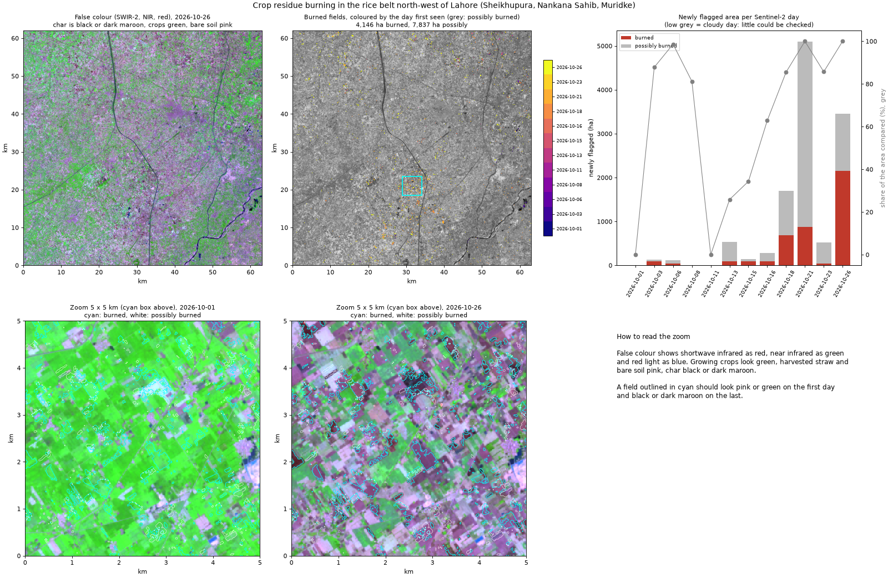

# smog_locator

**Mapping crop residue burning around Lahore from Sentinel-2, field by field, during the smog season.**

Every October to December, after the rice harvest, farmers in Punjab burn the leftover straw to clear
their fields for wheat. The smoke adds to the smog over Lahore. Satellite fire points (the hot spots
shown on fire maps and on windy.com) only catch fires burning at the moment a satellite passes, and
farmers have shifted to burning later in the day. This project maps the **burn scars** instead: a
burned field stays black for days, whenever it burned. It is built step by step, with the burning
season of 2026 as it happens.

Study area: about 60 x 60 km of the rice belt north-west of Lahore, over Sheikhupura, Nankana Sahib
and Muridke (73.58-74.22 E, 31.35-31.89 N).

```powershell
python burn_data.py 2026-10-01 2026-10-27      # Sentinel-2 for every day with a pass, 20 m, into cache/
python burns.py 2026-10-01 2026-10-27          # burned fields, per day, and a figure, into runs/
```

## Step 1: burn scars

When a field of rice straw burns, it turns black. To Sentinel-2:

| Band | Dry straw (before) | Char (after) |
|---|---|---|
| Near infrared (B8A) | fairly bright | very dark |
| Shortwave infrared 2 (B12) | bright | darker, but drops less |

So the **Normalised Burn Ratio**, NBR = (NIR - SWIR2) / (NIR + SWIR2), drops sharply when a field burns.
Each pixel is compared with its own last clear look (`burns.py`):

- **burned**: NBR dropped by at least 0.20, NBR is now below 0, and the field is now **very dark in near
  infrared** (0.15 or less): char.
- **possibly burned**: the same drop, but near infrared between 0.15 and 0.25 (char mixed with bright
  ash, or something else), and the crop-fire index MIRBI (10 x SWIR2 - 9.8 x SWIR1 + 2) up by at least 0.4.
- Water and 40 m around it are left out, and each pixel counts once, on the day it is first flagged.

**Why the rules look like this** (checked on 18 and 21 October 2026, three clear days apart):

- **Harvest also drops NBR.** About 68,000 ha had a big NBR drop in those three days, mostly green rice
  being cut. Harvested straw stays fairly bright in near infrared (median 0.27); char does not. Images of
  the flagged fields show straw or bare fields turning dark maroon in false colour.
- **MIRBI separates harvest from burning**: it rose by a median 0.67 on "burned" pixels, against 0.20 on
  ordinary harvest.
- **River and canal edges** looked like burns when the water level shifted; hence the water mask.
- **Smog haze is visible in the images**: on 8 and 23 October blue reflectance more than doubled, and
  NDVI fell with it. NBR, built from near and shortwave infrared, which haze scatters much less, stayed
  steady. A burn index from the infrared bands is the right tool in smog season.

### 1 to 26 October 2026

| Sentinel-2 day | Area that could be compared | Newly burned (ha) | Newly possibly burned (ha) |
|---|---|---|---|
| 3 Oct | 88% | 87 | 48 |
| 6 Oct | 99% | 36 | 84 |
| 13-16 Oct | 26-63% (cloudy) | 277 | 690 |
| 18 Oct | 86% | 681 | 1,015 |
| 21 Oct | 100% | 872 | 4,222 |
| 23 Oct | 86% | 38 | 478 |
| 26 Oct | 100% | 2,155 | 1,297 |
| **Total** | | **4,146** | **7,837** |

([per day](runs/burns_2026-10-01_2026-10-27.csv))

- **Burning took off in the last ten days of October**, as the harvest moved on: more than 3,000 ha of
  clear burns between 18 and 26 October, against a few hundred before.
- **"Possibly burned" is uncertain**, and its jump on 21 October may be partly haze; step 2 will check
  both levels against satellite fire points.
- **This is an undercount**: fields that burned and were ploughed between two clear images, and small
  fields of a few 20 m pixels, can be missed.



## Roadmap

- [x] Step 1: burn scars from Sentinel-2 (NBR, MIRBI), October 2026 so far
- [ ] Step 2: satellite fire points (Sentinel-3 fire product, VIIRS); how much do fire counts miss?
- [ ] Step 3: rice fields only, so other dark changes are not mistaken for burns
- [ ] Step 4: the whole season, October to December 2026, per district, against 2025
- [ ] Step 5: smoke and wind: on which days did burning upwind line up with bad air in Lahore?
- [ ] Step 6: a field check in the rice belt; README, poster, v1.0

## Data and credits

Sentinel-2 L2A from [Microsoft Planetary Computer](https://planetarycomputer.microsoft.com/). Contains
modified Copernicus Sentinel data (2026).
