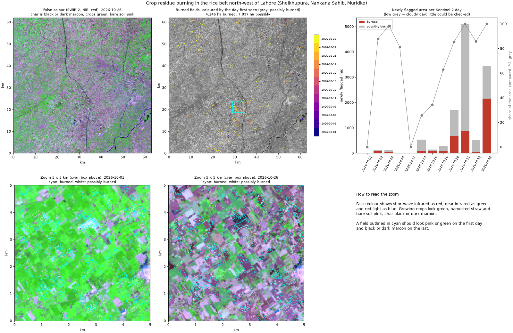
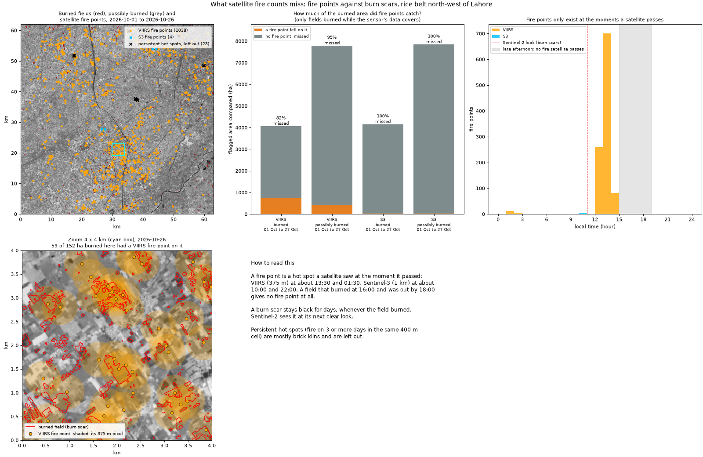
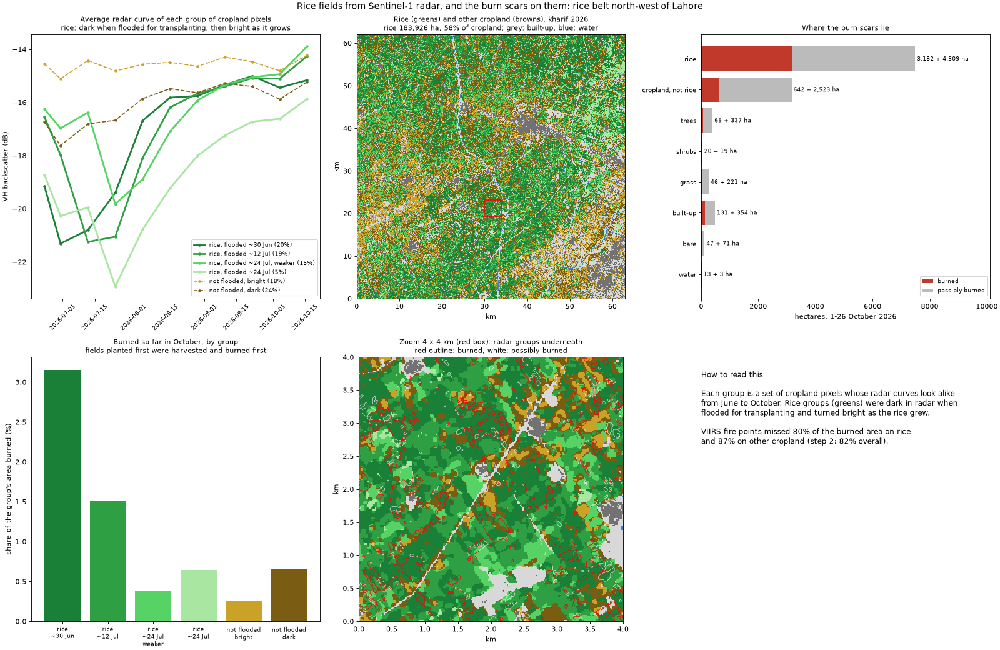
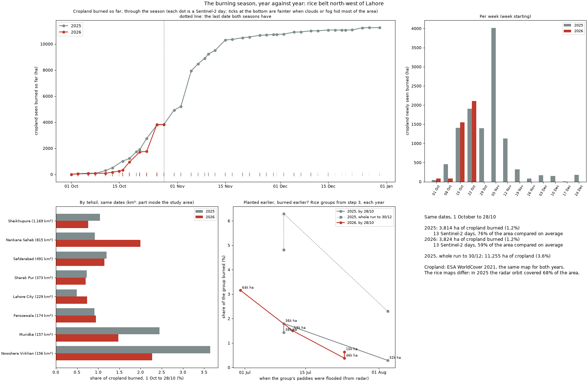
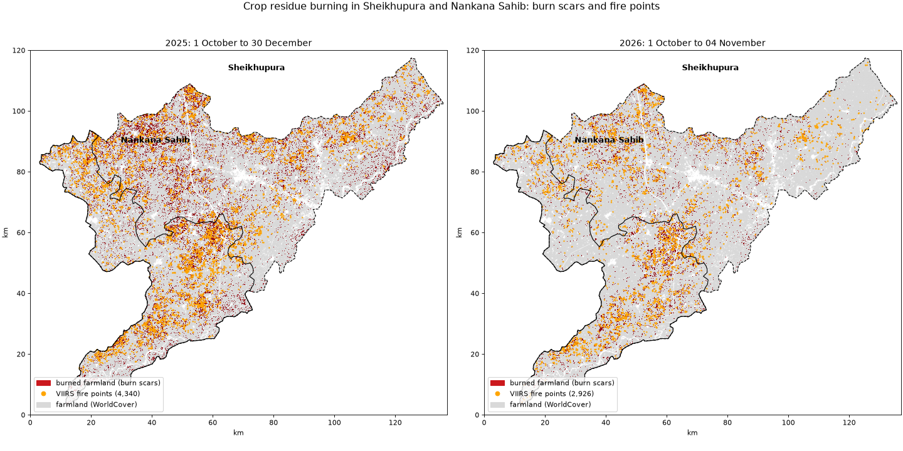
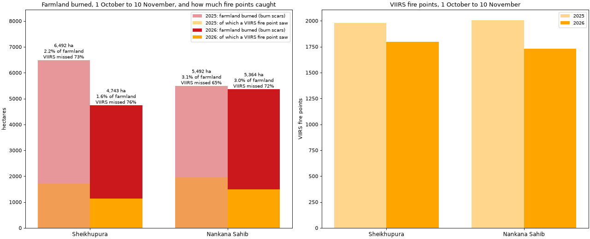
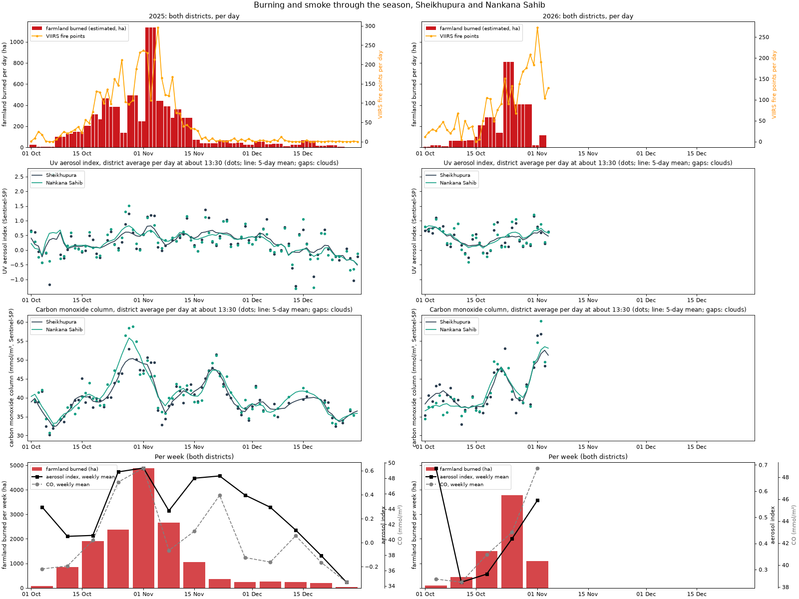
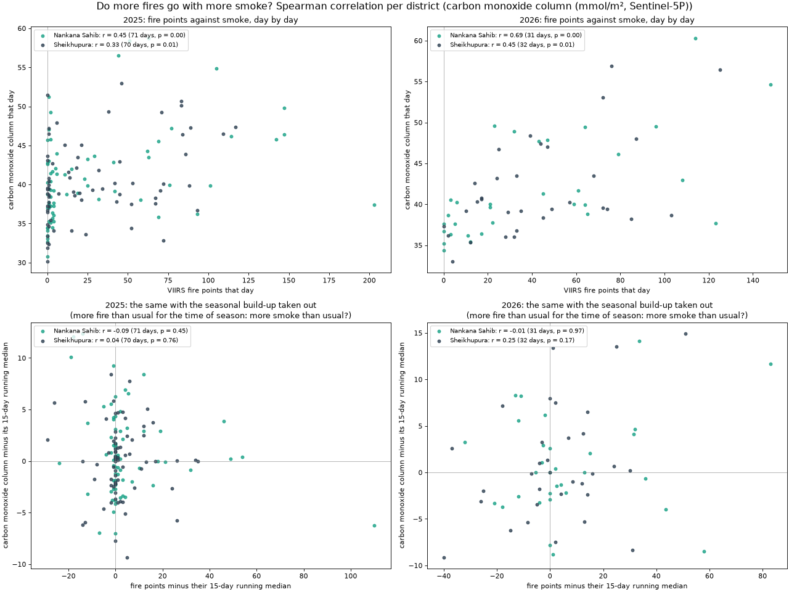

# smog_locator

**Mapping crop residue burning around Lahore from Sentinel-2, field by field, during the smog season.**

Every October to December, after the rice harvest, farmers in Punjab burn the leftover straw to clear
their fields for wheat. The smoke adds to the smog over Lahore. Satellite fire points (the hot spots
shown on fire maps and on windy.com) only catch fires burning at the moment a satellite passes, and
farmers have shifted to burning later in the day. This project maps the **burn scars** instead: a
burned field stays black for days, whenever it burned. It is built step by step, with the burning
season of 2026 as it happens.

Study area: about 60 x 60 km of the rice belt north-west of Lahore, over Sheikhupura, Nankana Sahib
and Muridke (73.58-74.22 E, 31.35-31.89 N). From step 5 on, the whole of Sheikhupura and Nankana
Sahib districts (about 5,800 km²).

```powershell
python burn_data.py 2026-10-01 2026-10-27      # Sentinel-2 for every day with a pass, 20 m, into cache/
python burns.py 2026-10-01 2026-10-27          # burned fields, per day, and a figure, into runs/
python fires.py 2026-10-01 2026-10-27          # satellite fire points against the burned fields
python rice.py                                 # rice fields from Sentinel-1 radar, and the burns on them
python rice.py --year 2025                     # last year's rice map
python season.py run 2025                      # the whole 2025 season, day by day (resumable)
python season.py run 2026                      # the 2026 season so far; run again as it goes on
python season.py report                        # both seasons on the same dates, by tehsil
```

Step 5 works on the two districts; set `SMOG_AREA=districts` first (`$env:SMOG_AREA = "districts"` in
PowerShell), which keeps its data in `cache/districts/` and its results in `runs/districts/`:

```powershell
python season.py run 2025                      # both seasons again, on the bigger area
python season.py run 2026
python smoke.py 2025-10-01 2025-12-31          # Sentinel-5P smoke over each district, once a day
python smoke.py 2026-10-01 2026-12-31
python districts.py fires                      # VIIRS fire points for both seasons (needs FIRMS_MAP_KEY)
python districts.py report                     # district table, daily and weekly series, smoke
```

## Step 1: burn scars

When a field of rice straw burns, it turns black. To Sentinel-2:

| Band | Dry straw (before) | Char (after) |
|---|---|---|
| Near infrared (B8A) | fairly bright | very dark |
| Shortwave infrared 2 (B12) | bright | darker, but drops less |

So the **Normalised Burn Ratio**, NBR = (NIR - SWIR2) / (NIR + SWIR2), drops sharply when a field burns.
Each pixel is compared with its own last clear look (`burns.py`):

- **burned**: NBR dropped by at least 0.20, NBR is now below 0, and the field is now **very dark in near
  infrared** (0.15 or less): char.
- **possibly burned**: the same drop, but near infrared between 0.15 and 0.25 (char mixed with bright
  ash, or something else), and the crop-fire index MIRBI (10 x SWIR2 - 9.8 x SWIR1 + 2) up by at least 0.4.
- Water and 40 m around it are left out, and each pixel counts once, on the day it is first flagged.

**Why the rules look like this** (checked on 18 and 21 October 2026, three clear days apart):

- **Harvest also drops NBR.** About 68,000 ha had a big NBR drop in those three days, mostly green rice
  being cut. Harvested straw stays fairly bright in near infrared (median 0.27); char does not. Images of
  the flagged fields show straw or bare fields turning dark maroon in false colour.
- **MIRBI separates harvest from burning**: it rose by a median 0.67 on "burned" pixels, against 0.20 on
  ordinary harvest.
- **River and canal edges** looked like burns when the water level shifted; hence the water mask.
- **Smog haze is visible in the images**: on 8 and 23 October blue reflectance more than doubled, and
  NDVI fell with it. NBR, built from near and shortwave infrared, which haze scatters much less, stayed
  steady. A burn index from the infrared bands is the right tool in smog season.

### 1 to 26 October 2026

| Sentinel-2 day | Area that could be compared | Newly burned (ha) | Newly possibly burned (ha) |
|---|---|---|---|
| 3 Oct | 88% | 87 | 48 |
| 6 Oct | 99% | 36 | 84 |
| 13-16 Oct | 26-63% (cloudy) | 277 | 690 |
| 18 Oct | 86% | 681 | 1,015 |
| 21 Oct | 100% | 872 | 4,222 |
| 23 Oct | 86% | 38 | 478 |
| 26 Oct | 100% | 2,155 | 1,297 |
| **Total** | | **4,146** | **7,837** |

([per day](runs/burns_2026-10-01_2026-10-27.csv))

- **Burning took off in the last ten days of October**, as the harvest moved on: more than 3,000 ha of
  clear burns between 18 and 26 October, against a few hundred before.
- **"Possibly burned" is uncertain**, and its jump on 21 October may be partly haze; step 2 will check
  both levels against satellite fire points.
- **This is an undercount**: fields that burned and were ploughed between two clear images, and small
  fields of a few 20 m pixels, can be missed.



## Step 2: what fire counts miss

The usual way to count crop fires is **fire points**: pixels a satellite sees as hot in the middle
infrared (about 4 µm, where a flame at 800-1,200 K outshines the ground at 300 K) at the moment it
passes. `fires.py` takes them from two sensors:

| Sensor | Pixel | Passes (local time) | Source |
|---|---|---|---|
| VIIRS (Suomi NPP, NOAA-20, NOAA-21) | 375 m | about 13:30 and 01:30 | NASA FIRMS |
| Sentinel-3 SLSTR fire product | 1 km | about 10:00 and 22:00 | Microsoft Planetary Computer |

A burned field from step 1 burned somewhere between its last clear Sentinel-2 look and the day it
showed char. It counts as **caught** when a fire point fell within one fire pixel (375 m for VIIRS,
1 km for Sentinel-3) of it inside that window. Only fields whose whole window lies inside a sensor's
data are compared. Points in a 400 m cell that was hot on 3 or more days (brick kilns, which leave no
scar) are left out: 23 points in 7 cells.

| Sensor | Burned area compared | Caught by a fire point | **Missed** |
|---|---|---|---|
| VIIRS, burned | 4,058 ha (1-26 Oct) | 727 ha | **82%** |
| VIIRS, possibly burned | 7,782 ha | 423 ha | 95% |
| Sentinel-3, burned | 4,146 ha (1-26 Oct) | 29 ha | over 99% |

([table](runs/fires_2026-10-01_2026-10-27.csv), [every fire point](runs/fires_2026-10-01_2026-10-27_points.csv))

- **VIIRS missed about four-fifths of the burned area.** This holds when the matching distance is
  loosened (within 750 m it still misses 72%, within 1.5 km, four VIIRS pixels, 54%) and on every big
  burning day: 76% missed for fields seen burned on 18 October, 81% on 21 October, 85% on 26 October.
- **The fire points it does have are real**: 730 of the 911 VIIRS points between the first and last
  Sentinel-2 look (80%) sit on a field that burned in the same window, and 173 of the other 181 have a
  burned field within 375 m, burned at another time (a neighbour, or a scar Sentinel-2 dated
  differently). Fire points are reliable; they just see a small part of the burning.
- **Fire points only exist at pass times.** 1,043 of the 1,061 VIIRS points are from the early
  afternoon pass and 18 from the night pass. Even with three satellites, VIIRS passed over the area
  only between about 12:00 and 14:30 and between 01:00 and 02:30 local time: it is blind for about
  20 hours a day (shaded in the figure), so the histogram shows the pass times, not when fields burn.
  Sentinel-3 found only 6 in 84 passes over the whole month: its morning and late-evening passes come
  when few fields burn, and a 1 km pixel needs a big fire to stand out. Burning in the late afternoon,
  between the passes, leaves no fire point at all, but it leaves a scar.
- **Farmers are reported to burn later on purpose.** In Indian Punjab, burning is widely reported to
  have shifted later in the afternoon once the satellite pass time became known. If the same happens
  here, fire counts will miss more and more of it, while a burn scar does not depend on the time of day.



VIIRS comes from the FIRMS archive, which needs a free MAP_KEY
([request one](https://firms.modaps.eosdis.nasa.gov/api/map_key/)) in the environment variable
`FIRMS_MAP_KEY`. Without a key, `fires.py` uses only the public files of the last 7 days; every
download is kept in `cache/firms/`, so running it weekly still builds up the season.

(The numbers above were recounted in step 5. The first version also picked up a few fire points from
after 27 October out of a newer 7-day file; `fires.py` now keeps only the dates asked for. The
result did not change: VIIRS still missed 82%.)

## Step 3: which burns are on rice

Step 1 flags anything that turned dark; step 3 asks where rice actually grew this season, from
Sentinel-1 radar, which sees through the monsoon clouds that hide July and August from Sentinel-2.

Rice is transplanted into **flooded** paddies. Standing water is a mirror to radar: the pulse
bounces away and VH backscatter is very low. As the rice grows, the pulse bounces between the stems
and the water and comes back, and VH rises by 6-7 dB. Sugarcane, orchards and fodder are never
flooded; villages stay bright.

`rice.py` takes 11 Sentinel-1 dates (one orbit, so the same viewing angle every time, 23 June to
16 October), keeps cropland from ESA WorldCover, and groups the pixels' radar curves into 6 groups
(k-means). A group is rice when its average curve was darkest between mid June and mid August (the
flood) and then rose by at least 4 dB. Cut-offs on single pixels did not work: neither the lowest VH
nor the rise splits into two clear humps, while the group curves are clean. (A first version also
asked for a flood level of -19.5 dB or below; step 4 showed that level fails in 2025, see below. The
2026 map is the same either way.)

| Group | Share of cropland | Burned in October | Share of the group burned | Greenness (NDVI) on 26 Oct |
|---|---|---|---|---|
| Rice, flooded ~30 June | 20% | 2,023 ha | **3.2%** | 0.27 |
| Rice, flooded ~12 July | 19% | 889 ha | 1.5% | 0.29 |
| Rice, flooded ~24 July (weaker flood) | 15% | 177 ha | 0.4% | 0.40 |
| Rice, flooded ~24 July | 5% | 93 ha | 0.6% | 0.46 |
| Not flooded, darker | 24% | 499 ha | 0.7% | 0.35 |
| Not flooded, bright (sugarcane, orchards) | 18% | 143 ha | 0.3% | 0.49 |

([groups](runs/rice_2026_groups.csv), [where the burns lie](runs/rice_2026_burns.csv))

- **Rice: 184,000 ha, 58% of the cropland** in the area.
- **77% of the burned area is on rice**, and rice burns at 1.7% of its area against 0.5% for other
  cropland, 3.6 times as often. Only 8% of the burned area (322 ha) lies outside cropland, 131 ha of
  it on WorldCover "built-up" (village edges, yards, or a 2021 map that is out of date).
- **"Possibly burned" is much less tied to rice**: 55% of it, close to the 58% of cropland that rice
  covers. Much of that class is probably not burning, as step 2 also suggested.
- **Fields planted first were harvested and burned first.** Rice flooded at the end of June holds
  half of all October's burned area (2,023 of 4,146 ha); the late-July rice is still partly green on 26 October (NDVI 0.40-0.46
  against 0.27) and has mostly not been burned yet. Greenness comes from Sentinel-2, independent of the
  radar, and agrees with the groups.
- **On rice alone, VIIRS fire points still missed 80%** of the burned area (3,141 ha compared), and
  87% on other cropland. Step 2's result is not an artefact of false scars outside rice.



## Step 4: the whole season, against 2025

`season.py` runs step 1's detection through a whole season, 1 October to 31 December, one
Sentinel-2 day at a time: 41 days for 2025, 13 so far for 2026. A season is too big to keep on disk
(about 90 MB a day), so the detection's state is saved after every day and a run picks up where it
stopped. The two years are compared **on the same dates** and **on the same cropland map** (ESA
WorldCover 2021), which does not depend on the radar.

**Three things went wrong on the way, and are fixed:**

- **28 October 2026 showed 146,000 ha "burned" in one day**, nearly the whole area. All eight scenes
  of that day on Planetary Computer hold values of 1-253 instead of reflectance x 10000 (26 October:
  median 3,994), under a normal-looking cloud mask. `burn_data.py` now skips a scene whose near
  infrared is below 0.01 over land, which no real field is, so 28 October counts as a day with
  nothing seen.
- **The 2025 rice map first found only 36,000 ha.** Two groups with clear rice curves (darkest in
  July or early August, then up by 5.5-6 dB) missed the -19.5 dB flood level by a few tenths: every
  2025 group sits 0.3-0.8 dB higher than in 2026. 80-84% of those groups' fields were rice again in
  2026, and they burned at rice rates. The rise alone separates rice from the rest in both years
  (5.5-7.1 dB against 0.9-3.0), so the rule now uses only the rise.
- **In 2025, Sentinel-1 orbit 100 covered only 68% of the area** (the eastern strip, with Muridke,
  Nowshera Virkhan and Kamoke, is missing from all 12 dates). The rice maps are compared only where
  both years have one: there, 52% of cropland was rice in 2025 and 54% in 2026, and 83% of 2025's
  rice fields were rice again in 2026.

| | 2025, 1-28 Oct | 2026, 1-28 Oct | 2025, whole season |
|---|---|---|---|
| Sentinel-2 days | 13 | 13 | 41 |
| Area compared, average | 76% | 59% (cloudier) | 72% |
| **Cropland burned** | **3,814 ha (1.2%)** | **3,824 ha (1.2%)** | **11,255 ha (3.6%)** |
| Rice burned, where both years have a rice map | 1.2% | 1.6% | 4.6% |

([same dates](runs/season_same_dates.csv), [per day 2025](runs/season_2025.csv),
[per day 2026](runs/season_2026.csv), [tehsils](runs/season_tehsils.csv),
[rice groups](runs/season_rice_groups.csv))

- **2026 is on the same track as 2025**: 3,824 against 3,814 ha of cropland burned by 28 October,
  although fewer of 2026's days were clear. Burning in the second half of October was slightly
  ahead of last year's.
- **Most of the season is still to come.** In 2025 only a third of the season's burning (34%) had
  been seen by 28 October. The peak was the week from 5 November (about 4,000 ha of cropland in one
  week, 2,700 ha of it on the single clear day of 5 November); by 15 November 92% was done, and December
  added little. If 2026 follows, the first half of November is the time to watch.
- **Planted earlier, burned earlier, in both years.** By 28 October 2025 the rice flooded around
  10 July had burned 1.4-1.8%, the rice flooded around 3 August 0.3%; in 2026 the order is the same
  (late June 3.2%, mid July 1.5%, late July 0.4-0.6%). By the end of 2025 the late group had still
  burned less than half as much (2.3% against 4.8-6.3%).
- **By tehsil** (cropland burned, 1-28 October; tehsils only partly inside the area are a sample of
  the tehsil, not all of it): Nankana Sahab more than doubled (0.9% to 2.0%); the north-east,
  Nowshera Virkhan, Kamoke and Muridke, burned most per hectare in 2025 (2.4-4.8%) and is lower so
  far this year (1.5-2.6%). Sheikhupura, the biggest tehsil in the area, burned 1.0% then and 0.8% now.
- **These are scars seen, a lower bound.** Even at the end of 2025, 95% of the rice in the area
  showed no burn scar. Fields burned and ploughed between two clear images, small fields, and straw
  burned in heaps rather than spread are missed, and December fog hid most days (the faint ticks in
  the figure).



Tehsil boundaries: [geoBoundaries](https://www.geoboundaries.org/) (Pakistan, ADM3), in `data/`.

## Step 5: district by district, and the smoke

Steps 1-4 worked on a 60 km box, which cuts across districts. Step 5 covers **the whole of
Sheikhupura and Nankana Sahib districts** and asks three questions for each: how many fire points
VIIRS picked up, how much farmland the burn scars show, and how much of that burned farmland the
fire points missed. Then: does the smoke over a district rise and fall with its burning?

- **Districts** are built from geoBoundaries tehsils (`data/districts.geojson`): Sheikhupura =
  Sheikhupura, Ferozewala, Muridke, Safdarabad and Sharak Pur; Nankana Sahib = Nankana Sahab, Shah Kot
  and Shangla Hill. The geoBoundaries district file still shows Sheikhupura from before 2005, with
  Nankana Sahib inside it, so it is not used.
- **Farmland** is ESA WorldCover cropland: 297,778 ha in Sheikhupura and 176,994 ha in Nankana Sahib.
- **Burn scars** come from step 4's season run on the bigger grid (6,000 x 6,850 pixels at 20 m): 41
  Sentinel-2 days for 2025, 14 for 2026 up to 31 October.
- **Fire points** come from the FIRMS archive: the final (standard) processing for 2025 and near real
  time for 2026. Persistent hot spots are left out, as in step 2.
- **Burning per day**: a scar is only known to have burned between two Sentinel-2 looks, so each
  burned pixel is spread evenly over the afternoons in its window. Sums over a week are close; single
  days are an estimate.

| Farmland burned (burn scars) | 2025, 1-31 Oct | 2026, 1-31 Oct | 2025, 1 Oct-10 Nov | 2026, 1 Oct-10 Nov | 2025, whole season |
|---|---|---|---|---|---|
| Sheikhupura | 3,897 ha (1.3%) | 3,207 ha (1.1%) | 6,492 ha (2.2%) | 4,743 ha (1.6%) | 8,783 ha (2.9%) |
| Nankana Sahib | 2,288 ha (1.3%) | **3,415 ha (1.9%)** | 5,492 ha (3.1%) | 5,364 ha (3.0%) | 6,353 ha (3.6%) |
| **Both districts** | **6,184 ha (1.3%)** | **6,622 ha (1.4%)** | **11,984 ha (2.5%)** | **10,107 ha (2.1%)** | **15,137 ha (3.2%)** |
| VIIRS fire points, both districts | 2,258 | 2,222 | 3,987 | 3,527 | 4,340 |
| Burned farmland with a fire point on it | 1,826 of 6,134 ha | 1,779 of 6,606 ha | 3,657 of 11,933 ha | 2,620 of 10,091 ha | 4,013 of 15,086 ha |
| **Missed by VIIRS** | **70%** (Sheikhupura 71%, Nankana Sahib 69%) | **73%** (75%, 72%) | **69%** (73%, 65%) | **74%** (76%, 72%) | **73%** (78%, 67%) |

([districts](runs/districts/districts.csv), [per day](runs/districts/districts_daily.csv),
[per week](runs/districts/districts_weekly.csv). "Burned farmland with a fire point on it" counts
farmland burned while VIIRS data covers it; a first version also counted burned land outside farmland,
which moved each share by about one point.)

- **Fire points saw about a quarter of the burned farmland**, in both districts and both years (65-78%
  missed). Step 2's result from the box (82%) holds over the two whole districts.
- **October 2026 burned about as much as October 2025** (+7%), but the burning moved: Nankana Sahib
  burned half as much again (+49%), Sheikhupura 18% less.
- **2026 has fallen behind 2025.** It was ahead until 4 November (6,926 ha against 6,687), but by
  10 November it had burned 10,107 ha against 11,984 by the same date in 2025 (16% less). In 2025 the
  burning surged from 5 November, the busiest fire day of that season (296 fire points). In 2026 fire
  points peaked earlier, on 1 November (270), and have fallen since (74-77 a day on 9-10 November).
  Either 2026 peaked earlier, or the burning is still to come; 10 November was only 49% clear, so
  the next images will tell. In 2025, 79% of the season's burned farmland had been seen by 10 November.
- **Smog on 2 November made the uncertain class grow, but it hid few burns.** On 2 November 2026, the
  day after the busiest fire day, Sentinel-2 flagged 250 ha as burned and 4,388 ha as possibly burned
  over the whole image box, and 70 and 240 ha in the two districts' farmland. (Last week's version of
  this README gave the box numbers as if they were the districts'.) The next image clear over those
  fields, 7 November, shows that most were not burns: 19% of the "possibly burned" area looked burned
  (dark in near infrared, low NBR), against 72% of the area flagged burned that day and 4% of land never
  flagged; in district farmland, 6%, 71% and 3%. Smoke seems to push ordinary harvested fields into the
  uncertain class more than it hides burns. (A pixel once flagged "possibly burned" is never checked
  again, so the few real burns among them stay uncounted.)
- **"Possibly burned" doubled in 2026** (13,346 ha against 6,605), much of it on 21 October. That
  class is uncertain (step 2: fire points missed 95% of it, step 3: barely tied to rice), and haze
  may play a part, so it is not read as more burning.
- **December 2025 is uncertain**: from mid December about 200 ha a week was flagged on days when fog
  hid 54-88% of the area. Some is probably real (late fields, sugarcane trash), some may be fog edges.

**Is the result carried by tiny patches?** A 20 m pixel is 0.04 ha, and the smallest burns are the
least certain. Grouping touching burned pixels into patches:

| Patch size | Share of burned farmland, 2025 / 2026 | Missed by VIIRS, 2025 / 2026 |
|---|---|---|
| 1 pixel (0.04 ha) | 6% / 6% | 91% / 89% |
| 2-8 pixels (0.08-0.32 ha) | 20% / 19% | 89% / 87% |
| 9-24 pixels (0.36-0.96 ha) | 16% / 17% | 84% / 83% |
| 25-99 pixels (1-4 ha) | 26% / 27% | 75% / 75% |
| 100 pixels or more (4 ha and up) | 32% / 32% | 53% / 59% |
| **9 pixels or more (0.36 ha and up)** | **74% / 76%** | **68% / 70%** |

([patches](runs/districts/districts_patches.csv); 2025 whole season, 2026 to 10 November)

- **A quarter of the burned farmland is in patches under 0.36 ha**, and VIIRS misses nearly 90% of
  those. Leaving them all out, it still misses **68-70%**: the result is not carried by small, noisy
  patches.
- **Even big burns are missed half the time**: patches of 4 ha and more had no fire point on 53-59%
  of their area. A VIIRS fire point needs the field alight during a pass, whatever its size.





### Smoke

**Aerosol optical depth from Sentinel-3 was tried first and dropped** (`aod.py`). It had a value on
only 46 of 88 days in 2025 and 3 of 28 in October 2026, and the hazy scenes are exactly the ones its
retrieval flags as invalid or outlier: its monthly median *falls* from October to November 2025 (0.70,
0.53), when the smog gets worse.

**Sentinel-5P** (`smoke.py`) passes at about 13:30, with VIIRS, and gives a value on most days. Two
measurements, averaged over each district:

- **UV aerosol index**: particles that absorb ultraviolet light, which smoke does, but so does dust.
  Values on 86 of 91 days in 2025 and on 40 of 41 days of 2026 so far (to 10 November).
- **Carbon monoxide (CO) column**: a gas burning gives off. It lasts for weeks, so it builds up over
  the whole region rather than marking single fires. Values on 70-71 days in 2025 and 36-37 of 41 in
  2026.

**2026 has passed 2025's smokiest day twice**: CO over Nankana Sahib reached 60.3 mmol/m² on
2 November 2026 and **66.4 on 10 November** (58.6 over Sheikhupura); 2025's highest day was 58.8, on
29 October. 10 November was a quiet fire day (74 fire points in the two districts, against 270 on
1 November), and its CO comes from fewer clear pixels than usual: one more sign that the day's smoke is
not set by the day's local burning.

| Week from (2025) | Farmland burned | Fire points | Aerosol index | CO (mmol/m²) |
|---|---|---|---|---|
| 1 Oct | 78 ha | 55 | 0.30 | 36.2 |
| 8 Oct | 846 ha | 162 | 0.05 | 36.6 |
| 15 Oct | 1,912 ha | 561 | 0.06 | 39.9 |
| 22 Oct | 2,375 ha | 954 | 0.59 | 47.5 |
| **29 Oct** | **4,878 ha** | **1,312** | **0.62** | **49.3** |
| 5 Nov | 2,662 ha | 1,016 | 0.27 | 38.6 |
| 12 Nov | 1,052 ha | 196 | 0.54 | 41.1 |
| 19 Nov | 359 ha | 19 | 0.56 | 45.8 |
| 26 Nov | 248 ha | 26 | 0.40 | 37.7 |
| 3-30 Dec, per week | 30-262 ha | 2-26 | -0.33 to 0.29 | 34.5-40.5 |

Spearman correlation of each day's smoke with that day's fire points, per district:

| | 2025 Sheikhupura | 2025 Nankana Sahib | 2026 Sheikhupura, to 10 Nov | 2026 Nankana Sahib, to 10 Nov |
|---|---|---|---|---|
| CO, day by day | 0.33 | 0.45 | 0.40 | 0.63 |
| CO, seasonal trend taken out | 0.04 | -0.09 | 0.16 | -0.15 |
| Aerosol index, day by day | 0.13 | 0.26 | 0.06 | -0.02 |
| Aerosol index, seasonal trend taken out | -0.25 | -0.20 | -0.03 | -0.35 |

("Seasonal trend taken out": each series minus its 15-day running median, so the question becomes "more
fire than usual for the time of season, more smoke than usual?". [All correlations, with p-values and
days](runs/districts/districts_correlation.csv), also against farmland burned and with the smoke a day
later.)

- **CO follows the season.** In 2025 it rose with the burning and peaked in the same week (49.3 in the
  week from 29 October, the week with the most burned farmland), and the correlation day by day is
  clear (0.33-0.63).
- **Day to day, local fires do not explain the smoke.** With the seasonal build-up taken out, the CO
  correlation is small and not significant in all four cases (r from -0.15 to 0.16, p 0.35 or more). CO dropped to 38.6 the week after the
  peak, while 2,662 ha still burned, and rose again to 45.8 in the week from 19 November, when the two
  districts had only 19 fire points. Which day is smoky is set by something else: wind bringing smoke
  from elsewhere (burning in Indian Punjab peaks in mid November), or still air and inversions
  trapping it. Weather is not analysed here.
- **The aerosol index is not a smoke signal here.** Its highest week in October 2026 was the first
  (0.69), when almost nothing burned, which points to dust. With the trend taken out it even leans
  negative: on thick-haze days VIIRS may see fewer fires through the smoke.





## Roadmap

- [x] Step 1: burn scars from Sentinel-2 (NBR, MIRBI), October 2026 so far
- [x] Step 2: satellite fire points (Sentinel-3 fire product, VIIRS); how much do fire counts miss?
- [x] Step 3: rice fields from Sentinel-1 radar; which burns are on rice
- [x] Step 4: the whole season against 2025, per tehsil (2026 is updated as the season goes on)
- [x] Step 5: the whole of Sheikhupura and Nankana Sahib districts: fire points against burn scars,
  and smoke from Sentinel-5P (weather not analysed)
- [ ] Step 6: a field check in the rice belt; README, poster, v1.0

## Data and credits

Sentinel-2 L2A, Sentinel-1 RTC, ESA WorldCover 2021, the Sentinel-3 SLSTR fire product, Sentinel-3
SYNERGY aerosol and Sentinel-5P (TROPOMI) aerosol index and carbon monoxide from
[Microsoft Planetary Computer](https://planetarycomputer.microsoft.com/). Contains modified Copernicus
Sentinel data (2025-2026). VIIRS active fire data from [NASA FIRMS](https://firms.modaps.eosdis.nasa.gov/)
(standard processing and LANCE near real time). Tehsil boundaries from
[geoBoundaries](https://www.geoboundaries.org/) (CC BY 4.0); the district outlines are built from them.
