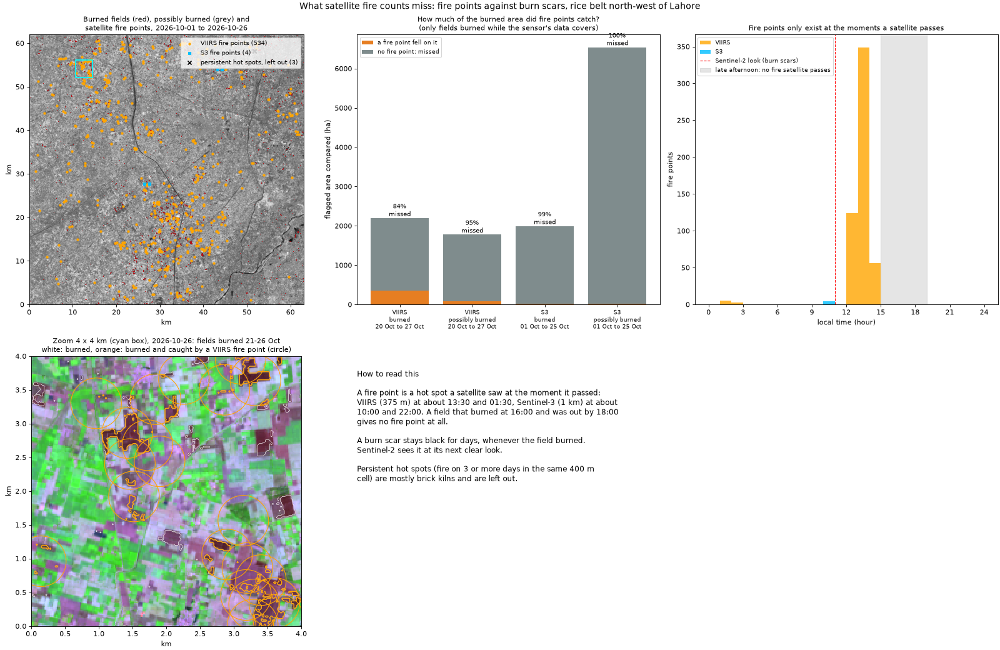
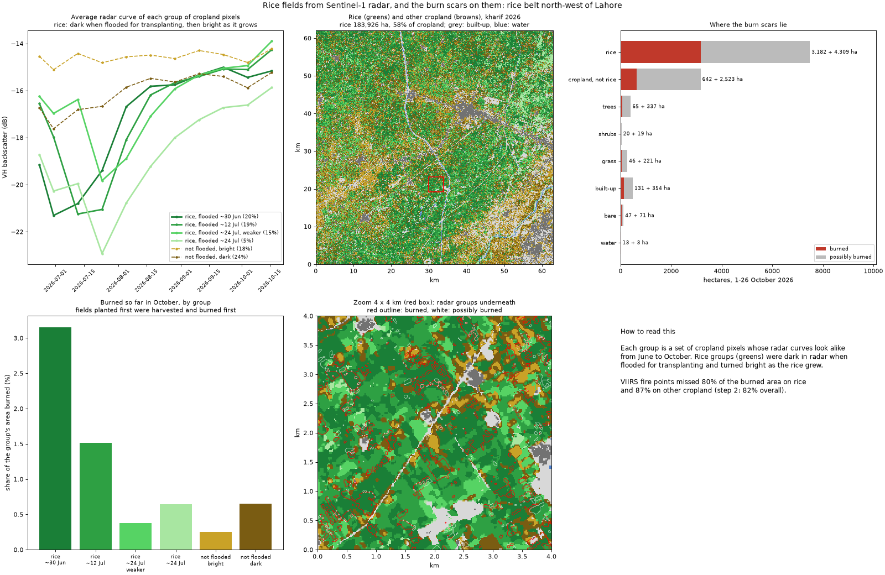
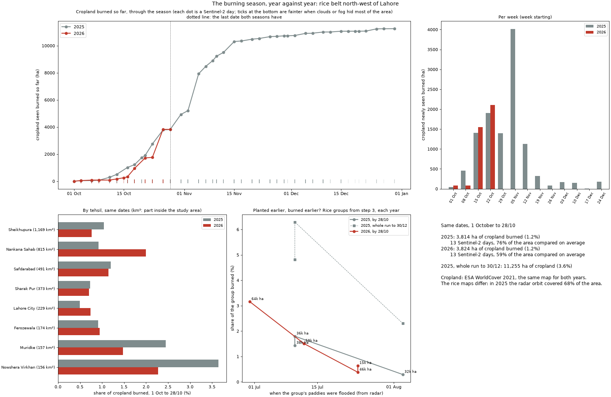

# smog_locator

**Mapping crop residue burning around Lahore from Sentinel-2, field by field, during the smog season.**

Every October to December, after the rice harvest, farmers in Punjab burn the leftover straw to clear
their fields for wheat. The smoke adds to the smog over Lahore. Satellite fire points (the hot spots
shown on fire maps and on windy.com) only catch fires burning at the moment a satellite passes, and
farmers have shifted to burning later in the day. This project maps the **burn scars** instead: a
burned field stays black for days, whenever it burned. It is built step by step, with the burning
season of 2026 as it happens.

Study area: about 60 x 60 km of the rice belt north-west of Lahore, over Sheikhupura, Nankana Sahib
and Muridke (73.58-74.22 E, 31.35-31.89 N).

```powershell
python burn_data.py 2026-10-01 2026-10-27      # Sentinel-2 for every day with a pass, 20 m, into cache/
python burns.py 2026-10-01 2026-10-27          # burned fields, per day, and a figure, into runs/
python fires.py 2026-10-01 2026-10-27          # satellite fire points against the burned fields
python rice.py                                 # rice fields from Sentinel-1 radar, and the burns on them
python rice.py --year 2025                     # last year's rice map
python season.py run 2025                      # the whole 2025 season, day by day (resumable)
python season.py run 2026                      # the 2026 season so far; run again as it goes on
python season.py report                        # both seasons on the same dates, by tehsil
```

## Step 1: burn scars

When a field of rice straw burns, it turns black. To Sentinel-2:

| Band | Dry straw (before) | Char (after) |
|---|---|---|
| Near infrared (B8A) | fairly bright | very dark |
| Shortwave infrared 2 (B12) | bright | darker, but drops less |

So the **Normalised Burn Ratio**, NBR = (NIR - SWIR2) / (NIR + SWIR2), drops sharply when a field burns.
Each pixel is compared with its own last clear look (`burns.py`):

- **burned**: NBR dropped by at least 0.20, NBR is now below 0, and the field is now **very dark in near
  infrared** (0.15 or less): char.
- **possibly burned**: the same drop, but near infrared between 0.15 and 0.25 (char mixed with bright
  ash, or something else), and the crop-fire index MIRBI (10 x SWIR2 - 9.8 x SWIR1 + 2) up by at least 0.4.
- Water and 40 m around it are left out, and each pixel counts once, on the day it is first flagged.

**Why the rules look like this** (checked on 18 and 21 October 2026, three clear days apart):

- **Harvest also drops NBR.** About 68,000 ha had a big NBR drop in those three days, mostly green rice
  being cut. Harvested straw stays fairly bright in near infrared (median 0.27); char does not. Images of
  the flagged fields show straw or bare fields turning dark maroon in false colour.
- **MIRBI separates harvest from burning**: it rose by a median 0.67 on "burned" pixels, against 0.20 on
  ordinary harvest.
- **River and canal edges** looked like burns when the water level shifted; hence the water mask.
- **Smog haze is visible in the images**: on 8 and 23 October blue reflectance more than doubled, and
  NDVI fell with it. NBR, built from near and shortwave infrared, which haze scatters much less, stayed
  steady. A burn index from the infrared bands is the right tool in smog season.

### 1 to 26 October 2026

| Sentinel-2 day | Area that could be compared | Newly burned (ha) | Newly possibly burned (ha) |
|---|---|---|---|
| 3 Oct | 88% | 87 | 48 |
| 6 Oct | 99% | 36 | 84 |
| 13-16 Oct | 26-63% (cloudy) | 277 | 690 |
| 18 Oct | 86% | 681 | 1,015 |
| 21 Oct | 100% | 872 | 4,222 |
| 23 Oct | 86% | 38 | 478 |
| 26 Oct | 100% | 2,155 | 1,297 |
| **Total** | | **4,146** | **7,837** |

([per day](runs/burns_2026-10-01_2026-10-27.csv))

- **Burning took off in the last ten days of October**, as the harvest moved on: more than 3,000 ha of
  clear burns between 18 and 26 October, against a few hundred before.
- **"Possibly burned" is uncertain**, and its jump on 21 October may be partly haze; step 2 will check
  both levels against satellite fire points.
- **This is an undercount**: fields that burned and were ploughed between two clear images, and small
  fields of a few 20 m pixels, can be missed.


## Step 2: what fire counts miss

The usual way to count crop fires is **fire points**: pixels a satellite sees as hot in the middle
infrared (about 4 µm, where a flame at 800-1,200 K outshines the ground at 300 K) at the moment it
passes. `fires.py` takes them from two sensors:

| Sensor | Pixel | Passes (local time) | Source |
|---|---|---|---|
| VIIRS (Suomi NPP, NOAA-20, NOAA-21) | 375 m | about 13:30 and 01:30 | NASA FIRMS |
| Sentinel-3 SLSTR fire product | 1 km | about 10:00 and 22:00 | Microsoft Planetary Computer |

A burned field from step 1 burned somewhere between its last clear Sentinel-2 look and the day it
showed char. It counts as **caught** when a fire point fell within one fire pixel (375 m for VIIRS,
1 km for Sentinel-3) of it inside that window. Only fields whose whole window lies inside a sensor's
data are compared. Points in a 400 m cell that was hot on 3 or more days (brick kilns, which leave no
scar) are left out: 20 points in 8 cells.

| Sensor | Burned area compared | Caught by a fire point | **Missed** |
|---|---|---|---|
| VIIRS, burned | 4,058 ha (1-26 Oct) | 728 ha | **82%** |
| VIIRS, possibly burned | 7,782 ha | 423 ha | 95% |
| Sentinel-3, burned | 1,991 ha (1-25 Oct) | 20 ha | 99% |

([table](runs/fires_2026-10-01_2026-10-27.csv), [every fire point](runs/fires_2026-10-01_2026-10-27_points.csv))

- **VIIRS missed about four-fifths of the burned area.** This holds when the matching distance is
  loosened (within 750 m it still misses 72%, within 1.5 km, four VIIRS pixels, 54%) and on every big
  burning day: 76% missed for fields seen burned on 18 October, 81% on 21 October, 85% on 26 October.
- **The fire points it does have are real**: 732 of the 913 VIIRS points between the first and last
  Sentinel-2 look (80%) sit on a field that burned in the same window, and 173 of the other 181 have a
  burned field within 375 m, burned at another time (a neighbour, or a scar Sentinel-2 dated
  differently). Fire points are reliable; they just see a small part of the burning.
- **Fire points only exist at pass times.** 1,043 of the 1,060 VIIRS points are from the early
  afternoon pass and 17 from the night pass. Sentinel-3 found only 4 in 76 passes over the whole month:
  its morning and late-evening passes come when few fields burn, and a 1 km pixel needs a big fire to
  stand out. Burning in the late afternoon, between the passes, leaves no fire point at all, but it
  leaves a scar.



VIIRS comes from the FIRMS archive, which needs a free MAP_KEY
([request one](https://firms.modaps.eosdis.nasa.gov/api/map_key/)) in the environment variable
`FIRMS_MAP_KEY`. Without a key, `fires.py` uses only the public files of the last 7 days; every
download is kept in `cache/firms/`, so running it weekly still builds up the season.

## Step 3: which burns are on rice

Step 1 flags anything that turned dark; step 3 asks where rice actually grew this season, from
Sentinel-1 radar, which sees through the monsoon clouds that hide July and August from Sentinel-2.

Rice is transplanted into **flooded** paddies. Standing water is a mirror to radar: the pulse
bounces away and VH backscatter is very low. As the rice grows, the pulse bounces between the stems
and the water and comes back, and VH rises by 6-7 dB. Sugarcane, orchards and fodder are never
flooded; villages stay bright.

`rice.py` takes 11 Sentinel-1 dates (one orbit, so the same viewing angle every time, 23 June to
16 October), keeps cropland from ESA WorldCover, and groups the pixels' radar curves into 6 groups
(k-means). A group is rice when its average curve was darkest between mid June and mid August (the
flood) and then rose by at least 4 dB. Cut-offs on single pixels did not work: neither the lowest VH
nor the rise splits into two clear humps, while the group curves are clean. (A first version also
asked for a flood level of -19.5 dB or below; step 4 showed that level fails in 2025, see below. The
2026 map is the same either way.)

| Group | Share of cropland | Burned in October | Share of the group burned | Greenness (NDVI) on 26 Oct |
|---|---|---|---|---|
| Rice, flooded ~30 June | 20% | 2,023 ha | **3.2%** | 0.27 |
| Rice, flooded ~12 July | 19% | 889 ha | 1.5% | 0.29 |
| Rice, flooded ~24 July (weaker flood) | 15% | 177 ha | 0.4% | 0.40 |
| Rice, flooded ~24 July | 5% | 93 ha | 0.6% | 0.46 |
| Not flooded, darker | 24% | 499 ha | 0.7% | 0.35 |
| Not flooded, bright (sugarcane, orchards) | 18% | 143 ha | 0.3% | 0.49 |

([groups](runs/rice_2026_groups.csv), [where the burns lie](runs/rice_2026_burns.csv))

- **Rice: 184,000 ha, 58% of the cropland** in the area.
- **77% of the burned area is on rice**, and rice burns at 1.7% of its area against 0.5% for other
  cropland, 3.6 times as often. Only 8% of the burned area (322 ha) lies outside cropland, 131 ha of
  it on WorldCover "built-up" (village edges, yards, or a 2021 map that is out of date).
- **"Possibly burned" is much less tied to rice**: 55% of it, close to the 58% of cropland that rice
  covers. Much of that class is probably not burning, as step 2 also suggested.
- **Fields planted first were harvested and burned first.** Rice flooded at the end of June holds
  half of all October's burned area (2,023 of 4,146 ha); the late-July rice is still partly green on 26 October (NDVI 0.40-0.46
  against 0.27) and has mostly not been burned yet. Greenness comes from Sentinel-2, independent of the
  radar, and agrees with the groups.
- **On rice alone, VIIRS fire points still missed 80%** of the burned area (3,141 ha compared), and
  87% on other cropland. Step 2's result is not an artefact of false scars outside rice.



## Step 4: the whole season, against 2025

`season.py` runs step 1's detection through a whole season, 1 October to 31 December, one
Sentinel-2 day at a time: 41 days for 2025, 13 so far for 2026. A season is too big to keep on disk
(about 90 MB a day), so the detection's state is saved after every day and a run picks up where it
stopped. The two years are compared **on the same dates** and **on the same cropland map** (ESA
WorldCover 2021), which does not depend on the radar.

**Three things went wrong on the way, and are fixed:**

- **28 October 2026 showed 146,000 ha "burned" in one day**, nearly the whole area. All eight scenes
  of that day on Planetary Computer hold values of 1-253 instead of reflectance x 10000 (26 October:
  median 3,994), under a normal-looking cloud mask. `burn_data.py` now skips a scene whose near
  infrared is below 0.01 over land, which no real field is, so 28 October counts as a day with
  nothing seen.
- **The 2025 rice map first found only 36,000 ha.** Two groups with clear rice curves (darkest in
  July or early August, then up by 5.5-6 dB) missed the -19.5 dB flood level by a few tenths: every
  2025 group sits 0.3-0.8 dB higher than in 2026. 80-84% of those groups' fields were rice again in
  2026, and they burned at rice rates. The rise alone separates rice from the rest in both years
  (5.5-7.1 dB against 0.9-3.0), so the rule now uses only the rise.
- **In 2025, Sentinel-1 orbit 100 covered only 68% of the area** (the eastern strip, with Muridke,
  Nowshera Virkhan and Kamoke, is missing from all 12 dates). The rice maps are compared only where
  both years have one: there, 52% of cropland was rice in 2025 and 54% in 2026, and 83% of 2025's
  rice fields were rice again in 2026.

| | 2025, 1-28 Oct | 2026, 1-28 Oct | 2025, whole season |
|---|---|---|---|
| Sentinel-2 days | 13 | 13 | 41 |
| Area compared, average | 76% | 59% (cloudier) | 72% |
| **Cropland burned** | **3,814 ha (1.2%)** | **3,824 ha (1.2%)** | **11,255 ha (3.6%)** |
| Rice burned, where both years have a rice map | 1.2% | 1.6% | 4.6% |

([same dates](runs/season_same_dates.csv), [per day 2025](runs/season_2025.csv),
[per day 2026](runs/season_2026.csv), [tehsils](runs/season_tehsils.csv),
[rice groups](runs/season_rice_groups.csv))

- **2026 is on the same track as 2025**: 3,824 against 3,814 ha of cropland burned by 28 October,
  although fewer of 2026's days were clear. Burning in the second half of October was slightly
  ahead of last year's.
- **Most of the season is still to come.** In 2025 only a third of the season's burning (34%) had
  been seen by 28 October. The peak was the week from 5 November (about 4,000 ha of cropland in one
  week, 2,700 ha of it on the single clear day of 5 November); by 15 November 92% was done, and December
  added little. If 2026 follows, the first half of November is the time to watch.
- **Planted earlier, burned earlier, in both years.** By 28 October 2025 the rice flooded around
  10 July had burned 1.4-1.8%, the rice flooded around 3 August 0.3%; in 2026 the order is the same
  (late June 3.2%, mid July 1.5%, late July 0.4-0.6%). By the end of 2025 the late group had still
  burned less than half as much (2.3% against 4.8-6.3%).
- **By tehsil** (cropland burned, 1-28 October; tehsils only partly inside the area are a sample of
  the tehsil, not all of it): Nankana Sahab more than doubled (0.9% to 2.0%); the north-east,
  Nowshera Virkhan, Kamoke and Muridke, burned most per hectare in 2025 (2.4-4.8%) and is lower so
  far this year (1.5-2.6%). Sheikhupura, the biggest tehsil in the area, burned 1.0% then and 0.8% now.
- **These are scars seen, a lower bound.** Even at the end of 2025, 95% of the rice in the area
  showed no burn scar. Fields burned and ploughed between two clear images, small fields, and straw
  burned in heaps rather than spread are missed, and December fog hid most days (the faint ticks in
  the figure).



Tehsil boundaries: [geoBoundaries](https://www.geoboundaries.org/) (Pakistan, ADM3), in `data/`.

## Roadmap

- [x] Step 1: burn scars from Sentinel-2 (NBR, MIRBI), October 2026 so far
- [x] Step 2: satellite fire points (Sentinel-3 fire product, VIIRS); how much do fire counts miss?
- [x] Step 3: rice fields from Sentinel-1 radar; which burns are on rice
- [x] Step 4: the whole season against 2025, per tehsil (2026 is updated as the season goes on)
- [ ] Step 5: smoke and wind: on which days did burning upwind line up with bad air in Lahore?
- [ ] Step 6: a field check in the rice belt; README, poster, v1.0

## Data and credits

Sentinel-2 L2A, Sentinel-1 RTC, ESA WorldCover 2021 and the Sentinel-3 SLSTR fire product from
[Microsoft Planetary Computer](https://planetarycomputer.microsoft.com/). Contains modified Copernicus
Sentinel data (2025-2026). VIIRS active fire data from [NASA FIRMS](https://firms.modaps.eosdis.nasa.gov/)
(LANCE near real time). Tehsil boundaries from [geoBoundaries](https://www.geoboundaries.org/)
(CC BY 4.0).
